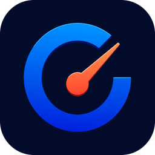

<p align="center">
  
</p>

<h1 align="center">StoreGauge</h1>

<p align="center">
  Your app-store business, one glance away.<br />
  A private, native Mac and iPhone dashboard for App Store Connect and Google Play.
</p>

<p align="center">
  <a href="#requirements"></a>
  <a href="#privacy"></a>
  <a href="LICENSE"></a>
  <a href="https://github.com/Phil9l/storegauge/stargazers"></a>
  <a href="https://github.com/Phil9l/storegauge/releases/latest"></a>
  <a href="https://github.com/Phil9l/storegauge/releases"></a>
  <a href="https://github.com/Phil9l/storegauge/commits/main"></a>
  <a href="https://github.com/Phil9l/storegauge/actions/workflows/deploy-pages.yml"></a>
</p>

StoreGauge brings App Store Connect and Google Play data together without sending your business data to another service. Apple accounts include reviews, proceeds, downloads, subscriptions, app statuses, metadata history, and TestFlight signals; Google Play accounts include app discovery, written reviews and replies, production release status, installs and updates, Android crash and ANR rates, estimated gross sales, and finalized earnings. The Mac client lives in the menu bar and refreshes in the background; both clients keep their data local.

The iPhone client uses the same native models and store integrations, but remains
fully independent: accounts, credentials, and downloaded data stay on that phone
and do not sync with the Mac. When notifications are enabled, it asks iOS for a
short background review and release-status check no earlier than hourly. iOS
chooses the actual execution time, so alerts are best-effort rather than a
guaranteed hourly service.

**[Website](https://phil9l.github.io/storegauge/)** · **[Documentation](https://phil9l.github.io/storegauge/docs/)** · **[Privacy](https://phil9l.github.io/storegauge/privacy/)** · **[Releases](https://github.com/Phil9l/storegauge/releases)**

> [!IMPORTANT]
> Your private key stays in the device Keychain. StoreGauge has no account system, backend, telemetry, or cloud database.

## Highlights

- **One dashboard for every app and team** — connect multiple App Store Connect and Google Play accounts, discover apps automatically, choose which apps contribute to combined views, pin favorites, and archive apps without deleting their history.
- **A real review inbox** — triage reviews into Needs Reply, Acknowledged, and Answered; translate non-matching languages on-device (manually or automatically); switch between and copy original or translated text; reply or edit on either store; and export CSV.
- **Revenue without misleading totals** — see Apple developer proceeds alongside Google Play estimated gross sales and finalized earnings, clearly separated and converted to one display currency; Apple also includes IAP vs paid sales, refunds, subscriptions, MRR, and trials.
- **Performance that stays readable** — inspect downloads, updates, impressions, product-page views, conversion, sessions, active devices, and Android crash/ANR rates with native Swift Charts; toggle new installs and updates independently when you want a cleaner signal.
- **Release awareness** — track App Store and Google Play production states, plus phased-release progress, metadata changes, screenshots, beta groups, tester counts, and TestFlight crash feedback for Apple apps.
- **Useful alerts** — get notified about new reviews, state changes, newly discovered apps, rollout completion, and unusual week-over-week movement. On iPhone, local background checks focus on reviews and release status.
- **Menu bar and widgets** — keep the review count visible in the menu bar, or add configurable Performance and New Feedback widgets for all selected apps or one specific app.
- **Local MCP server** — let Codex, Claude, and other MCP clients inspect portfolio metrics, reviews, and release status through an optional, read-only helper.
- **Built-in demo** — explore two realistic local apps with 90 days of metrics and a multilingual review inbox, without store credentials.

## Requirements

- macOS 15 or later
- iOS 18 or later for the iPhone client
- Xcode 26.3 or later to build from source
- For Apple: an App Store Connect account with permission to create a Team API key
- For Google Play: a Google Cloud service account invited to Play Console

## Quick start

1. Clone the repository and open `StoreGauge/StoreGauge.xcodeproj`.
2. Select **StoreGauge** for Mac or **StoreGaugeMobile** for iPhone.
3. In **Signing & Capabilities**, choose the same development team for the **StoreGauge**, **StoreGaugeWidgets**, and **StoreGaugeMCP** targets. Widgets and MCP status sharing require the App Group capability.
4. Run with **Product → Run** (`⌘R`).
5. Open **Settings → Accounts → Add Account** and follow the built-in setup guide.

To verify a source checkout without signing:

```bash
xcodebuild \
  -project StoreGauge/StoreGauge.xcodeproj \
  -scheme StoreGauge \
  -configuration Debug \
  -sdk macosx \
  CODE_SIGNING_ALLOWED=NO \
  build
```

## Connect App Store Connect

StoreGauge explains these steps inside the Add Account sheet, including links to the relevant App Store Connect pages.

1. Open [Users and Access → Integrations → App Store Connect API](https://appstoreconnect.apple.com/access/integrations/api).
2. Create a dedicated **Team API key** named StoreGauge and choose the lowest role that covers the features you need. Use **Admin** only if you want access to every StoreGauge feature. Individual API keys cannot download Sales or Finance reports.
3. Copy the **Issuer ID** and **Key ID**, then download `AuthKey_XXXXXXXXXX.p8`. Apple allows the private key to be downloaded only once.
4. Optional: open [Payments and Financial Reports](https://appstoreconnect.apple.com/itc/payments_and_financial_reports#/) and copy the **Vendor Number** shown under your legal entity name. This enables proceeds and subscription reporting.
5. Enter the values in StoreGauge and select **Test & Add**. The first sync backfills the available history and can take a little longer.

| Credential | Where StoreGauge keeps it | Used for |
|---|---|---|
| Issuer ID and Key ID | Local SwiftData store | Identifying the API key |
| `.p8` private key | Device Keychain | Signing short-lived App Store Connect JWTs |
| Vendor Number | Local SwiftData store | Sales, proceeds, and subscription reports |

## Connect Google Play

The Add Account sheet links directly to each setup page and validates access to both Google APIs before saving.

1. In one Google Cloud project, enable the [Google Play Android Developer API](https://console.cloud.google.com/apis/library/androidpublisher.googleapis.com) and [Google Play Developer Reporting API](https://console.cloud.google.com/apis/library/playdeveloperreporting.googleapis.com).
2. Create a service account, then create and download a JSON key for it.
3. Open **Users and permissions inside the relevant Play developer account**, then invite the JSON file's `client_email` as a new user. The account-specific URL looks like `https://play.google.com/console/u/0/developers/<developer-id>/users-and-permissions`. The [generic Users and permissions link](https://play.google.com/console/users-and-permissions) lets you select the developer account first. Grant access to the apps, **Global View app information (read-only)**, and **Reply to reviews**.
4. Optional performance reports: open **Download reports → Statistics** and copy the private Cloud Storage bucket ID (`pubsite_prod_rev_…`) into StoreGauge. This enables daily user installs and device updates. For income, also grant **Global View financial data**. See [Google's report guide](https://support.google.com/googleplay/android-developer/answer/6135870?hl=en).
5. In StoreGauge choose **Add Account → Google Play Console**, select the JSON key, optionally enter the Play report bucket, and choose **Test & Add**.

The complete JSON key stays in the device Keychain. StoreGauge uses it only to sign short-lived OAuth assertions locally. Statistics and financial CSV files are parsed locally and raw transaction rows are not retained. Install exports and estimated sales normally lag by 3–7 days; finalized earnings come from the payout-oriented monthly earnings report, usually available around the 5th of the following month. Android vitals come directly from the Play Developer Reporting API. Ratings without text and testing-track feedback are not included. Google currently exposes the new Play Console acquisition funnel only through manual CSV export, so StoreGauge imports install statistics but not traffic-source or conversion analysis.

## Demo mode

Choose **Add Account**, select either store, and enter `test` in every visible field. Optional fields may be blank or `test`. **Test & Add** then creates two local apps with 90 days of deterministic metrics, releases, subscriptions, income, and multilingual reviews. Review replies and status changes work locally, and no Apple or Google request or credential is used.

This mode is suitable for App Review: include the steps above in the App Review notes so the reviewer can exercise the complete interface without receiving credentials. Demo accounts are labeled **Demo** and can be deleted like any other account.

## Widgets

StoreGauge includes two configurable widgets in medium and large sizes:

- **Performance** shows seven-day downloads and proceeds, week-over-week movement, and 30-day trends.
- **New Feedback** shows the reviews that still need attention, with a compact all-caught-up state when the queue is empty.

Choose a specific app in the widget configuration, or leave **App** empty to combine the apps selected in StoreGauge. Clicking a widget deep-links to the relevant app, overview, or reviews inbox.

The widget extension never receives API credentials or direct database access. The main app publishes a small, read-only JSON snapshot to the shared App Group after sync and review actions.

## MCP for local agents

StoreGauge bundles a native stdio [Model Context Protocol](https://modelcontextprotocol.io/) server. Open **Settings → Integrations**, enable sharing, choose whether to include review text and financial data, then select Codex, Claude Code, Claude Desktop, or another MCP client for tailored setup. The MCP indicator at the bottom of the app is always clickable—even when MCP is off or no agent is connected—and opens setup instructions and activity details. Concurrent clients are tracked as separate sessions.

The server provides read-only tools for portfolio summaries, app discovery, daily performance, complete paginated metric and review history, releases, localized listing metadata and changes, and chart annotations. It reads a sanitized snapshot of non-archived apps from the App Group; it cannot access Keychain credentials, call Apple or Google, or modify StoreGauge. Sharing is off by default, and you can restrict the export to apps selected for the dashboard.

Example Codex configuration:

```toml
[mcp_servers.storegauge]
command = "/Applications/StoreGauge.app/Contents/MacOS/storegauge-mcp"
```

After changing the setting or data scope, use **Refresh Data** or run a normal sync. Restart or reconnect the agent after changing its MCP configuration.

## Privacy

StoreGauge is local-first by design:

- API private keys are stored in the Mac or iPhone Keychain and are marked device-only, never placed in the app database or migrated through device backups.
- App and analytics data are stored locally with SwiftData.
- Review translations use Apple’s on-device Translation framework, follow the system language by default, and are cached locally for the selected target language.
- Widget data is a minimal snapshot shared only between StoreGauge and its widget extension.
- Optional MCP sharing uses a separate, credential-free read-only snapshot. Review text and financial fields can be excluded independently.
- Connector diagnostics use a small rolling local log containing operation names, HTTP status codes, and errors—never credentials, tokens, response bodies, or review text. Click a sync error in the bottom status bar or use **Settings → General → Diagnostics** to reveal `~/Library/Logs/StoreGauge/StoreGauge.log`.
- Network requests go to Apple's App Store Connect API, Google's OAuth, Play, and Cloud Storage APIs, the public Apple and Google Play listings for app icons, and—when currency conversion is needed—the [Frankfurter](https://www.frankfurter.app/) exchange-rate API.
- There is no StoreGauge server, user account, tracking SDK, or analytics collector.

## Architecture

| Concern | Implementation |
|---|---|
| Authentication | Locally signed short-lived JWTs: ES256 for Apple and RS256 for Google |
| Networking | `URLSession` with async/await, pagination, token refresh, and rate-limit backoff |
| Storage | SwiftData for product data; Keychain for private keys |
| Store providers | Capability-driven App Store Connect and Google Play connectors with store-scoped identifiers |
| Reports | Gzipped App Store Connect reports plus Google Play UTF-16 statistics and zipped financial CSVs parsed locally |
| Interface | SwiftUI, Swift Charts, Translation, Natural Language, `NavigationSplitView`, and `MenuBarExtra` |
| Widgets | WidgetKit and App Intents over a minimal App Group snapshot |
| Agent integration | Official MCP Swift SDK over stdio, backed by a sanitized App Group snapshot |
| Dependencies | Apple frameworks, the official MCP Swift SDK, and Sparkle 2 for direct-distribution updates |

```text
StoreGauge/
├── Shared/                  Widget-safe snapshot models and storage
├── StoreGauge/
│   ├── API/                 Apple and Google API clients and report parsers
│   ├── App/                 App coordinator and lifecycle
│   ├── Models/              SwiftData and domain models
│   ├── Providers/           Store capabilities, identities, and connector registry
│   ├── Security/            Keychain and Apple/Google JWT signing
│   ├── Support/             Aggregation, formatting, export, and settings
│   ├── Sync/                Sync engine, polling, notifications, snapshots
│   └── Views/               Dashboard, reviews, details, settings, and charts
├── StoreGaugeWidgets/       Performance and New Feedback widgets
├── StoreGaugeMCP/           Bundled read-only MCP stdio server
├── StoreGaugeTests/         Unit tests
└── StoreGaugeUITests/       UI tests
```

## Contributing

Issues and pull requests are welcome. Please read [CONTRIBUTING.md](CONTRIBUTING.md) and the [Contributor License Agreement](CLA.md) before submitting a contribution. Keep new integrations local-first, avoid adding service dependencies without a clear reason, and include focused tests for parsing or aggregation changes.

Before opening a pull request, build the main scheme and run the unit tests in Xcode. A signed local build needs valid profiles for both bundle identifiers and their shared App Group.

## Direct distribution and updates

The macOS app includes Sparkle 2 and a **Check for Updates…** app-menu command. Its feed is configured for `https://phil9l.github.io/storegauge/appcast.xml`; the Astro site in `docs` publishes it from `docs/public/appcast.xml`.

Fastlane provides verification and release entry points for both clients:

```sh
bundle install
bundle exec fastlane ios verify
bundle exec fastlane mac verify
```

For iPhone, the `ios build`, `ios beta`, and `ios release` lanes create a signed
IPA, upload to TestFlight, or attach a binary to an App Store version. For
desktop, `mac preflight` and `mac direct` wrap the signed, notarized DMG
workflow, while `mac app_store_build` and `mac app_store` package and upload the
Sparkle-free Mac App Store target. See
[fastlane/README.md](fastlane/README.md) for credential setup, lane options, and
publishing safeguards.

Create a `Developer ID Application` certificate in Xcode, save notarization credentials once with `xcrun notarytool store-credentials storegauge-notary`, then run:

```sh
./scripts/release-preflight.sh
./scripts/build-release.sh
```

The preflight is read-only and validates the release machine, notarization profile, Sparkle key match, sandbox entitlements, and appcast. The build script requires a clean working tree, increments the patch version and build number, archives and exports a Developer ID build, creates a DMG with an Applications shortcut, notarizes and staples it, and verifies it with Gatekeeper. The result is written to `build/releases/`. Pass `--version X.Y.Z` to choose an explicit version. If any release step fails, the script restores the original version numbers.

After testing the DMG, commit the version bump and publish the exact file in a matching GitHub release. Then run `./scripts/generate-appcast.sh build/releases vX.Y.Z` and commit the updated `docs/public/appcast.xml`. GitHub Actions builds and publishes the site after changes land on `main`.

The Sparkle EdDSA private key is stored in the developer login Keychain under account `storegauge`; only its public key is committed. Back up the private key securely before shipping. The separate `StoreGaugeAppStore` target excludes Sparkle, its feed keys and Mach-service exceptions, and its update UI.

## License

StoreGauge is source-available under the
[PolyForm Noncommercial License 1.0.0](LICENSE). You may inspect, build,
modify, and share it for noncommercial purposes; commercial use requires a
separate written license.

The StoreGauge name, logo, icon, and other brand identifiers are governed by
the [StoreGauge Trademark Policy](TRADEMARKS.md) and are not licensed for use
in redistributed applications. Required attribution is listed in
[NOTICE](NOTICE).
